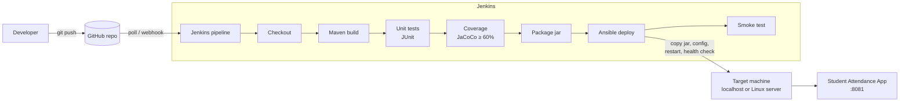

# End-to-End DevOps Pipeline for an Online Student Attendance System

**Tools:** GitHub · Maven · Jenkins · Ansible  
**Application:** Java 17 · Spring Boot 3 · Thymeleaf · H2 database · JUnit 5 · JaCoCo

Every `git push` to GitHub automatically triggers Jenkins, which builds the app with Maven, runs the
unit tests, checks code coverage, packages a jar and hands it to Ansible. Ansible deploys it, restarts it
and confirms it is healthy. No manual steps are needed between pushing code and the new version being live.

---

## 1. Architecture



| Stage | Tool | What happens |
|---|---|---|
| Source control | GitHub | Code, `Jenkinsfile` and Ansible playbooks are versioned together |
| Build | Maven | `mvn clean compile` downloads dependencies and compiles |
| Test | Maven + JUnit 5 | 36 unit/integration tests; results published in Jenkins |
| Quality gate | JaCoCo | Build fails if line coverage < 60% |
| Package | Maven | Creates `target/student-attendance.jar` and archives it in Jenkins |
| Deploy | Ansible | Copies the jar as a versioned release, writes config, restarts the app, waits for `/actuator/health` = `UP` |
| Verify | curl | Smoke test of health, dashboard and API |
| Rollback | Ansible | `rollback.yml` switches back to the previous release in one command |

## 2. The application

| Page | URL | Purpose |
|---|---|---|
| Dashboard | `/` | Totals, today's attendance, students below 75% |
| Students | `/students` | Add / delete students (roll no, name, department, semester, email) |
| Mark Attendance | `/attendance` | Pick a date, mark each student Present / Late / Absent |
| Reports | `/reports` | Per-student classes, attended, percentage (low ones highlighted) |

The footer shows `v1.0.0 · build #N`. N is the Jenkins build number, so you can see each deployment go live.

**REST API** (handy for demos with curl or Postman):

| Method | Endpoint | Description |
|---|---|---|
| GET | `/api/students` | List students |
| POST | `/api/students` | Add a student (JSON) |
| GET/DELETE | `/api/students/{id}` | Get / delete one student |
| GET | `/api/attendance?date=YYYY-MM-DD` | Attendance sheet for a date |
| POST | `/api/attendance` | `{"date":"2026-11-05","statuses":{"1":"PRESENT","2":"ABSENT"}}` |
| GET | `/api/reports/summary` | Per-student percentages |
| GET | `/api/reports/dashboard` | Dashboard numbers |
| GET | `/actuator/health`, `/actuator/info` | Health and build info (used by Ansible and Jenkins) |

On first start the app loads 6 sample students and two weeks of attendance so the dashboard isn't empty.
Turn this off with `app.seed-demo-data=false` in `application.properties`.

## 3. Project structure

```
.
├── Jenkinsfile                     # CI/CD pipeline (8 stages)
├── pom.xml                         # Maven build, dependencies, JaCoCo coverage gate
├── ansible/
│   ├── ansible.cfg
│   ├── inventory.ini               # [local] = this Mac, [servers] = remote Linux machines
│   ├── group_vars/all.yml          # port, paths, health-check settings
│   ├── deploy.yml                  # deployment playbook
│   ├── rollback.yml                # roll back to the previous release
│   ├── tasks/restart.yml           # shared restart + health check
│   └── templates/                  # app config + systemd service
└── src/
    ├── main/java/com/mbu/attendance/
    │   ├── model/                  # Student, AttendanceRecord, AttendanceStatus
    │   ├── repository/             # Spring Data JPA repositories
    │   ├── service/                # business logic
    │   ├── web/                    # page controllers
    │   ├── api/                    # REST controller + error handling
    │   ├── dto/                    # report / dashboard objects
    │   └── config/DemoDataSeeder.java
    ├── main/resources/             # templates (Thymeleaf), CSS, application.properties
    └── test/                       # JUnit 5 tests
```

## 4. Setup on macOS (one time)

Install [Homebrew](https://brew.sh) if you don't have it, then:

```bash
brew install --cask temurin@21     # Java (17 or newer works)
brew install maven ansible git jenkins-lts
```

Check everything:

```bash
java -version && mvn -version && ansible --version && git --version
```

### 4.1 Run the app by itself first

```bash
cd ~/Desktop/"Devops Mini"
mvn clean verify          # compile + 36 tests + coverage check
mvn spring-boot:run       # then open http://localhost:8081
```

Stop it with `Ctrl + C` before continuing.

### 4.2 Push to GitHub

Create an empty repository on GitHub (e.g. `student-attendance-devops`, no README), then:

```bash
cd ~/Desktop/"Devops Mini"
git init
git add .
git commit -m "Online Student Attendance System with Jenkins + Ansible pipeline"
git branch -M main
git remote add origin https://github.com/<your-username>/student-attendance-devops.git
git push -u origin main
```

### 4.3 Start and configure Jenkins

```bash
brew services start jenkins-lts
cat ~/.jenkins/secrets/initialAdminPassword
```

1. Open http://localhost:8080 and paste the password.
2. Choose **Install suggested plugins** (this includes Pipeline, Git and JUnit) and create your admin user.
3. **New Item** → name `student-attendance-pipeline` → **Pipeline** → OK.
4. Under **Pipeline**:
   - Definition: **Pipeline script from SCM**
   - SCM: **Git**, Repository URL: your GitHub repo URL (add credentials if the repo is private)
   - Branch: `*/main`
   - Script Path: `Jenkinsfile`
5. Save → **Build Now**.

The first build takes a few minutes while Maven downloads dependencies. After it finishes, the job shows
**Build with Parameters** (`DEPLOY`, `TARGET`), test results and the archived jar.

Open http://localhost:8081: the app is now running, deployed by Ansible.

### 4.4 Demo: code change → automatic deployment

1. Make a visible change, e.g. edit the `<h1>Dashboard</h1>` text in
   `src/main/resources/templates/dashboard.html`.
2. `git commit -am "Update dashboard title" && git push`
3. Within ~2 minutes Jenkins notices the commit (the `pollSCM` trigger) and runs all stages.
4. Refresh http://localhost:8081: the new title appears and the footer build number goes up.

To show the quality gate, break a test (e.g. change an expected value in `AttendanceServiceTest`), push it,
and watch the pipeline stop at **Unit Tests** without deploying.

## 5. Running Ansible by hand

```bash
mvn clean package
cd ansible
ansible-playbook deploy.yml --limit local          # deploy to this Mac
ansible-playbook rollback.yml --limit local        # go back to the previous release
ansible-playbook rollback.yml --limit local -e rollback_to=12   # a specific Jenkins build
```

On the Mac the app is installed in `~/student-attendance/`:

```
~/student-attendance/
├── current.jar -> releases/student-attendance-<build>.jar
├── releases/          # last 5 builds kept for rollback
├── config/application.properties   # written by Ansible
├── data/              # H2 database (survives redeploys)
└── logs/
```

### Deploying to a Linux server (VM or AWS EC2)

1. Uncomment and edit the `web1` line under `[servers]` in `ansible/inventory.ini`.
2. Make sure you can `ssh` to it with that key.
3. Run the Jenkins job with **TARGET = servers**, or by hand: `ansible-playbook deploy.yml --limit servers`.

On Linux, Ansible also installs Java 17, creates an `attendance` system user and runs the app as a
**systemd** service in `/opt/student-attendance` (`sudo systemctl status student-attendance`).
Open port 8081 in the server's firewall / security group.

## 6. Troubleshooting

| Problem | Fix |
|---|---|
| `mvn: command not found` in Jenkins | The Jenkinsfile adds `/opt/homebrew/bin` and `/usr/local/bin` to PATH. If Maven is elsewhere, run `which mvn` and add that folder to the `PATH` line in the Jenkinsfile. |
| `Unable to locate a Java Runtime` | Install Java with `brew install --cask temurin@21`. |
| Port 8081 already in use | `lsof -i :8081` then `kill <pid>`, or change `app_port` in `ansible/group_vars/all.yml` and `APP_URL` in the Jenkinsfile. |
| App stops when the Jenkins build ends | Keep the `JENKINS_NODE_COOKIE=dontKillMe` lines in the Jenkinsfile and `tasks/restart.yml`. |
| Health check times out | Check `~/student-attendance/logs/console.log`. |
| Coverage gate fails | See the archived `target/site/jacoco/index.html` in the Jenkins build. |
| Start fresh | Stop the app (`kill $(cat ~/student-attendance/app.pid)`) and delete `~/student-attendance/data`. |
